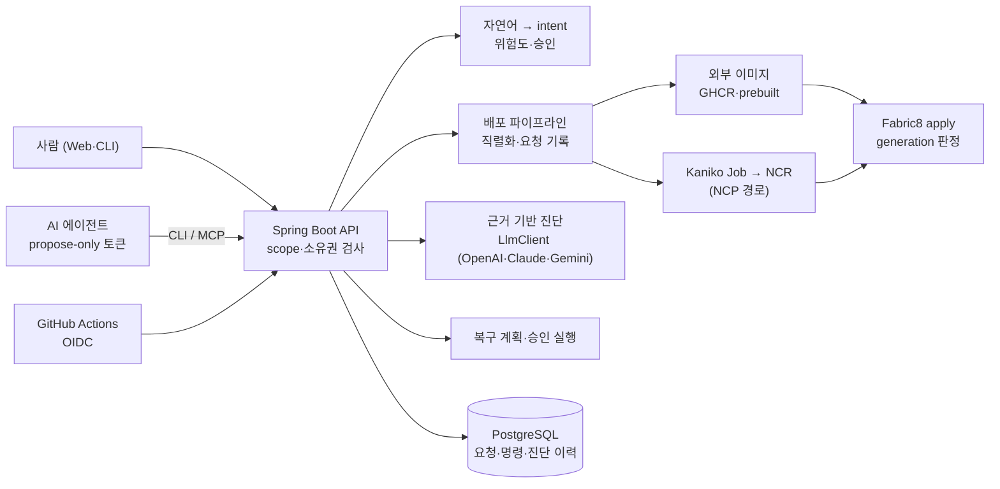

# K-Le-PaaS

K-Le-PaaS는 사람과 AI 에이전트가 함께 쓰는 **agent-safe Kubernetes 배포 제어면**입니다. 배포 요청마다 무엇이 적용됐고 왜 실패했는지 근거를 남기고, 실패를 근거 기반으로 진단하며, 에이전트는 복구를 **제안만** 하고 실행은 사람이 승인합니다.

> K-Le-PaaS is an agent-safe Kubernetes control plane: every deployment request is recorded and judged on its own rollout, failures are diagnosed from cited evidence, and agents can only propose recoveries that people approve.

## 한눈에 보기

| 문제 | K-Le-PaaS의 방식 |
|---|---|
| 배포가 "성공했다"는 판정이 실제로 그 요청이 적용한 버전인지 알 수 없다 | 요청이 적용한 Deployment generation만 판정하고, 대체·재시작·조회 불가는 `CANCELED`/`UNKNOWN`으로 드러낸다 (#53, #57) |
| 실패 원인을 찾으려면 kubectl로 Pod·이벤트·로그를 뒤져야 한다 | 요청별 적용 설정·직전 성공 대비 변경·Pod 로그·이벤트를 한 화면·API로 보여 주고, AI가 그 입력 안의 근거 위치(JSON Pointer)를 인용해 진단한다 (#95, #100) |
| AI 에이전트에게 운영 권한을 주기 무섭다 | 에이전트 토큰은 조회·진단·제안만 가능하다. 복구 제안은 계획 지문이 고정된 승인 대기 명령이 되고, 사람이 승인해야 실행된다 (#102, #103) |
| 승인한 뒤 설정이 바뀌면 다른 내용이 배포된다 | 승인 시점 설정 지문을 고정하고 apply 직전까지 비교해 다르면 실행하지 않는다 (#56) |
| 롤백이 이미지만 되돌려 설정 문제는 그대로다 | 이전 성공 배포의 이미지(digest 고정)와 env 외 설정을 함께 되돌리고, 값이 기록되지 않는 env 차이는 차단한다 (#101) |

## 핵심 기능

**배포 제어면**
- 두 빌드 경로: GitHub Actions/GHCR·사전 빌드 이미지(외부 이미지, 운영 사용 중)와 NCP Kaniko Job(소스 빌드). [ADR-0001](docs/adr/0001-external-image-build.md)
- 같은 앱 배포 직렬화·중복 접수 방지(#52), 요청이 적용한 generation 기준 rollout 판정(#53), 앱별 startup probe 허용 시간만큼 대기(#108)
- 요청별 기록: 요청 경로(웹·CLI·CI·webhook·자연어), 적용 설정 스냅샷(env는 이름과 HMAC 지문만), 관측 이미지 digest, 실패 종류(#95)
- 백엔드 재시작 후 미완료 배포·명령을 한 번 대조해 확정하거나 `UNKNOWN`으로 남김(자동 재실행 없음, #57)
- 앱별 readiness/startup probe, requests/limits, NodePort 전용 앱(#51, #107)

**안전 장치**
- 자연어 명령을 intent로 해석 → 위험도(LOW/MEDIUM/HIGH) 분류 → MEDIUM 이상은 확인 후 실행. 셸 명령은 실행하지 않는다 ([ADR-0002](docs/adr/0002-intent-risk-confirmation.md))
- CLI 토큰 권한 범위(`read-only`, `propose-only`, 저장소별 배포 전용, `full`)를 서버가 강제(#49, #50), CI는 GitHub Actions OIDC로 저장 토큰 없이 배포(#65)
- 승인 설정 지문 고정(#56), 승인 10분 만료·동시 중복 차단, 저장소 소유권·namespace·라벨·허용 참조 검사 ([ADR-0006](docs/adr/0006-resource-access-scope.md))

**복구**
- 이전 성공 배포 후보·복구 계획(배포할 이미지, 되돌릴 설정, env 차이, 실행 가능 여부, 계획 지문) → 같은 지문일 때만 실행(#101)

**근거 기반 AI 진단 (실험)**
- 배포 상세·로그를 비밀값을 가린 채 모델에 보내고, 라벨 목록 안의 범주·구체 원인과 입력 안의 근거 위치를 받는다. 목록 밖 라벨·없는 근거는 서버가 버린다. 원인을 확정할 수 없으면 판단 보류(#100)
- 공급사 교체 구조(OpenAI·Claude·Gemini, 공식 SDK). 사례 12개로 품질·비용·지연을 비교해 기본 모델 선택(#100)
- 결과 이력 저장·재사용, 관측 근거가 없으면 모델 호출 생략(#117)
- 운영문서·확정 장애 이력 RAG(#104). 독립 평가에서 개선이 없어 기본으로 끔(#123, #129)

**에이전트 연결**
- 구조화된 복구 제안 API·CLI(#102), 원격 MCP 서버 `/api/v1/mcp`(공식 MCP Java SDK, 도구 7개, #103). [MCP 문서](docs/MCP.md)

## 구조



플랫폼 자체는 `main` 머지 시 GitHub Actions가 ARM64 릴리스를 만들어 Oracle 서버(systemd)에 배포하고, readiness·revision 확인에 실패하면 이전 릴리스로 되돌립니다([CICD.md](docs/CICD.md)). 사용자 앱은 같은 서버의 k3s에 배포합니다([Oracle k3s + GHCR 안내](docs/ORACLE_K3S_GHCR_DEPLOYMENT.md)).

## 검증 결과

**운영 전 과정 실증** (#105, 운영, 샘플 Node 앱) — 코드 수정·서버 수동 패치 0회

| 단계 | 실패 | 진단 | 복구 |
|---|---|---|---|
| probe 포트 변경 | READINESS_TIMEOUT | probe_port_closed (앱 문서 인용) | 사람이 원인 확정 → 에이전트 제안 → 사람 승인 → 성공 |
| 없는 이미지 태그 | IMAGE_PULL | image_not_pullable | 제안 → 승인 → 성공 |
| 필수 env 삭제 | CRASH_LOOP | required_env_missing | 복구 계획이 실행 불가로 차단(env 값 미저장) → 운영자가 env 복원 |
| 같은 실패 반복 | READINESS_TIMEOUT | probe_port_closed | 제안 → 승인 → 성공 |
| 기록 없는 과거 실패 | - | 모델 호출 없이 판단 보류 | - |

복구 3건은 digest 고정 이미지로 성공했고, 실패 동안 기존 Pod가 계속 응답했습니다. ([스펙 0105](docs/specs/0105-end-to-end-demo/spec.md))

**진단 평가** (#99 실패 사례 12개, 로컬 k3s에서 실제 캡처 8 + 가공 4)

| 방식 | 범주 | 구체 원인 | 근거 일치 | 판단 보류 | 12건 비용 |
|---|---|---|---|---|---|
| 규칙 기준선(실패 종류 고정 설명) | 6/10 | 0/10 | 2/10 | 2/12 | 0 |
| AI 진단 (OpenAI gpt-6-luna, 기본) | 10/10 | 10/10 | 10/10 | 12/12 | $0.0029 |

같은 사례로 Claude Haiku·Gemini Flash·gpt-5-mini도 비교했고, 품질이 같은 모델 중 비용·지연이 가장 낮은 모델을 기본으로 골랐습니다. ([스펙 0099](docs/specs/0099-diagnosis-eval-cases/spec.md), [0100](docs/specs/0100-evidence-based-diagnosis/spec.md))

**측정으로 내린 결정**
- 비용 절감(#115): 추론 강도·출력 간결화·입력 정리를 사례 12개 × 10회로 측정했으나 품질 기준을 넘지 못해 출력 상한과 토큰 로그만 적용했습니다. 계산 금액과 선불 잔액 차감액이 4% 안에서 맞았습니다. ([스펙 0115](docs/specs/0115-diagnosis-cost-reduction/spec.md))
- RAG(#104 → #123 → #129): 가공 사례에서는 구체 원인 15/25 → 25/25였지만, 다른 회사 모델(Gemini)이 독립 작성한 시나리오 71개를 k3s에서 재현한 평가용 39개 × 3회에서는 지식 없음 116/117, 있음 114/117로 개선이 없고 비용만 늘어 기본으로 껐습니다. ([스펙 0123](docs/specs/0123-blind-rag-eval/spec.md))
- MCP(#103): 실서버에서 Codex로 도구 7개 조회·진단·계획·제안, 입력 검증 오류, 권한 경계(배포 전용 토큰 403, 인증 없음 401)를 확인했습니다. ([스펙 0103](docs/specs/0103-mcp-server/spec.md))

## 현재 상태

| 영역 | 상태 | 설명 |
|---|---|---|
| 배포 (외부 이미지) | 운영 사용 | GHCR/prebuilt 이미지, OIDC CI 배포, 요청별 기록·판정·재시작 대조 |
| 배포 (Kaniko) | 구현, 운영 미사용 | NCP Object Storage + Kaniko Job + NCR 경로. 다른 provider(AWS·온프레미스 Kaniko)는 없음 |
| 배포 요청 상세·로그 | 구현 | API, CLI, 콘솔. 로그는 저장·스트리밍하지 않음 |
| 승인 복구 | 구현, 운영 실증 | #101, #105 |
| 자연어 명령 | 구현 | OpenAI `gpt-6-luna` 해석(설정으로 공급사 변경, #136), 위험도·승인, 명령 이력. 고정 입력 30개 × 5회 평가: 교체 후보 `gemini-3.8-flash` intent 92%, `gpt-6-luna` 95%, 두 모델 모두 확인 없이 변경 실행 해석 0 (#58) |
| AI 진단 | 실험, 운영 사용 | 근거 기반, 결과 재사용. RAG는 기본 꺼짐 |
| 에이전트·MCP | 구현, 실서버 확인 | 제안 전용 토큰, 복구 제안, `/api/v1/mcp` |
| CLI | 구현 | `auth`, `ask`, `confirm`, `history`, `repositories`, `deployments`, `knowledge`, `incidents`, `cost`, `doctor` |
| 비용 추정 | 구현 | spec 기반 plan·diff·explain·check (실제 청구 아님) |
| Slack·WebSocket 알림, GitHub webhook | 구현 MVP | Slack은 서버 환경 변수로 설정 |
| 콘솔 미리보기 화면 | 준비 중 | 모니터링, 알림, PR 목록, 대시보드 통계 일부, 설정의 조직·환경·Slack·에이전트 탭. 화면에 "준비 중"으로 표시하며 서버 동작에 영향 없음 |
| IaC / Terraform | 예정 | 구현 없음 |

알려진 격차는 [architecture §9](docs/architecture.md#9-알려진-격차)에 있습니다.

## 사용 인터페이스

### Web console

프론트엔드는 인증, 저장소 등록·배포 설정, 자연어 명령, 배포 상태·요청 상세·로그, AI 진단, 복구, CLI 토큰을 제공하는 브라우저 콘솔입니다. 모니터링 등 백엔드 API가 없는 화면은 "준비 중"으로 표시합니다.

```bash
cd frontend
npm install
npm run dev
```

기본 로컬 주소:

```text
http://localhost:3000
```

### Backend API

백엔드는 인증, 배포 오케스트레이션, 자연어 명령 처리, 위험 명령 확인, 비용 추정, CLI 인증, WebSocket 알림, webhook 처리를 담당하는 주 제어면입니다.

```bash
cd backend
./gradlew bootRun
```

기본 로컬 주소:

```text
http://localhost:8080
```

### CLI

CLI는 운영자, 자동화 스크립트, AI agent가 구조화된 출력과 명확한 exit code로 K-Le-PaaS를 사용할 수 있도록 하는 보조 제어면입니다.

```bash
cd frontend
npm run cli -- --help
npm run cli -- doctor
npm run cli -- auth login --web
npm run cli -- ask "default namespace pods 보여줘"
npm run cli -- confirm <commandLogId> --yes
npm run cli -- deployments list --repository-id 1 --json
npm run cli -- deployments wait <deploymentId> --timeout 600
npm run cli -- cost check --file docs/examples/cli-cost-spec.json --max-monthly 120000
```

CLI 환경변수:

```text
KLEPAAS_BASE_URL
KLEPAAS_TOKEN
KLEPAAS_REFRESH_TOKEN
```

자세한 명령은 [CLI_REFERENCE.md](docs/CLI_REFERENCE.md)를 참고하세요.

### MCP (AI agent)

Claude Code·Codex 같은 AI 에이전트는 MCP 서버 `<API_BASE>/api/v1/mcp`에 제안 전용 토큰으로 연결해 배포 조회, 실패 진단, 복구 계획 확인, 복구 제안을 할 수 있습니다. 승인·실행은 사람만 합니다.

```bash
claude mcp add --transport http klepaas "<API_BASE>/api/v1/mcp" --header "Authorization: Bearer $KLEPAAS_TOKEN"
```

연결 방법과 도구 목록은 [MCP.md](docs/MCP.md)를 참고하세요.

## Safety model

K-Le-PaaS는 운영 명령을 실행하기 전에 위험도를 분류합니다.

| 위험도 | 예시 | 동작 |
|---|---|---|
| LOW | list, status, overview, logs, cost estimate | 즉시 실행 |
| MEDIUM | restart, scale, 비파괴 설정 변경 | 사용자 확인 필요 |
| HIGH | deploy, rollback, delete, 파괴적 인프라 변경 | 대상과 영향 요약 후 사용자 확인 필요 |

사용자와 agent가 지켜야 할 원칙:

- MEDIUM / HIGH 명령의 confirmation을 우회하지 않습니다.
- 모니터링에는 조회 전용(`read-only`), agent에는 제안 전용(`propose-only`), CI에는 저장소별 배포 전용 CLI 토큰을 사용합니다. 서버가 범위 밖 요청을 403으로 거부합니다.
- 추측한 이름보다 명시적인 deployment ID, repository ID를 우선합니다.
- 자동화에서는 `--json` 출력과 exit code를 사용합니다.
- command log를 감사 가능한 실행 기록으로 취급합니다.
- 배포 추적을 위해 `latest`보다 commit SHA 같은 immutable image tag를 사용합니다.
- 에이전트에는 `propose-only` 토큰만 주고, MCP 도구로는 승인·실행을 할 수 없습니다. IaC/Terraform은 예정 기능입니다.

## 비용 인지

현재 비용 기능은 실제 billing API 조회가 아니라 배포 spec 기반 추정 모델입니다.

제공되는 CLI/API 흐름:

- `cost plan`: 예정 spec의 월 비용 추정
- `cost diff`: 현재 spec과 예정 spec의 비용 차이 비교
- `cost explain`: 비용 항목과 가정 설명
- `cost check`: 예산 한도 초과 시 자동화 실패 처리

이 기능의 목적은 배포 전에 비용 변화를 인지하게 하는 것입니다. 향후 IaC 흐름에서는 Terraform/OpenTofu plan, Infracost, policy check와 연결할 수 있습니다.

## 환경변수

백엔드 환경변수는 보통 `backend/.env`에 설정합니다.

```env
DB_URL=jdbc:postgresql://localhost:5432/klepaas
DB_USERNAME=klepaas
DB_PASSWORD=

GITHUB_CLIENT_ID=
GITHUB_CLIENT_SECRET=
GITHUB_REDIRECT_URI=http://localhost:3000/console/auth/callback

GITHUB_APP_ID=
GITHUB_APP_PRIVATE_KEY=
GITHUB_APP_SLUG=

NCP_ACCESS_KEY=
NCP_SECRET_KEY=
NCP_STORAGE_BUCKET=
NCR_ENDPOINT=

K8S_NAMESPACE=default
K8S_IMAGE_PULL_SECRET=ncp-cr
KANIKO_IMAGE=gcr.io/kaniko-project/executor:latest

# 자연어 명령 해석 모델 (#136). 기본 openai / gpt-6-luna. 선택한 공급사 키만 필요
NLP_LLM_PROVIDER=openai
NLP_LLM_MODEL=gpt-6-luna
GEMINI_API_KEY=
# AI 진단 모델 (#100). 기본 openai / gpt-6-luna. 선택한 공급사 키만 필요
DIAGNOSIS_LLM_PROVIDER=openai
DIAGNOSIS_LLM_MODEL=gpt-6-luna
OPENAI_API_KEY=
ANTHROPIC_API_KEY=
# 진단에 운영문서·확정 사건을 넣을지 (#129, 기본 false)
DIAGNOSIS_RAG_ENABLED=false

JWT_SECRET=
SLACK_WEBHOOK_URL=
GITHUB_WEBHOOK_SECRET=
```

프론트엔드 환경변수는 보통 `frontend/.env.local`에 설정합니다.

```env
NEXT_PUBLIC_API_URL=http://localhost:8080
NEXT_PUBLIC_WS_URL=ws://localhost:8080
NEXT_PUBLIC_BASE_PATH=/console
```

비밀값은 커밋하지 않습니다.

## 검증

로컬 환경에서 가능한 범위로 실행합니다.

```bash
cd backend
./gradlew test
./gradlew build
```

```bash
cd frontend
npm ci
npm run build
npm run cli -- doctor
```

Kubernetes 배포 확인:

```bash
kubectl get jobs,pods,deploy,svc,ingress -n <namespace>
kubectl rollout status deployment/<deployment-name> -n <namespace>
```

## 문서

개발 방식과 설계:
- [개발 절차 (Spec-Driven Development)](docs/specs/README.md), 이슈별 스펙·결과·회고는 [docs/specs/](docs/specs/)
- [제품 목표와 실행 순서](docs/product.md)
- [구조·권한·상태 모델·알려진 격차](docs/architecture.md)
- [결정 기록 (ADR)](docs/adr/README.md)
- [기여 가이드](CONTRIBUTING.md), [AI 에이전트 작업 규칙](AGENTS.md)

사용과 운영:
- [Backend README](backend/README.md)
- [Frontend README](frontend/README.md)
- [KLEPAAS 자체 CI/CD와 운영 복구](docs/CICD.md)
- [사용자 앱 Oracle k3s + GHCR 배포](docs/ORACLE_K3S_GHCR_DEPLOYMENT.md)
- [앱 접근 권한과 허용 참조 설정](docs/STAGE2_RESOURCE_ACCESS.md)
- [CLI 전략](docs/CLI_STRATEGY.md)
- [CLI 레퍼런스](docs/CLI_REFERENCE.md)
- [MCP 서버 연결과 도구](docs/MCP.md)
- [CLI 비용 예시](docs/examples/cli-cost-spec.json)

운영 검증 원자료, 개인 환경 메모, 공개하지 않는 설계 초안은 `.local/` 아래에서 관리하며 `.git/info/exclude`로 Git 추적에서 제외합니다.
